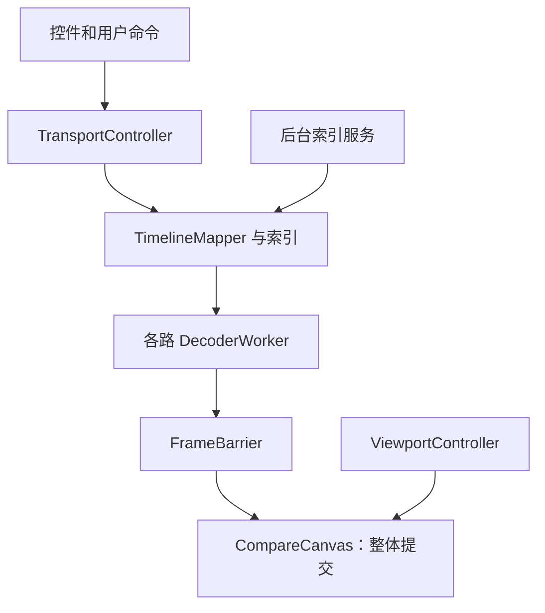
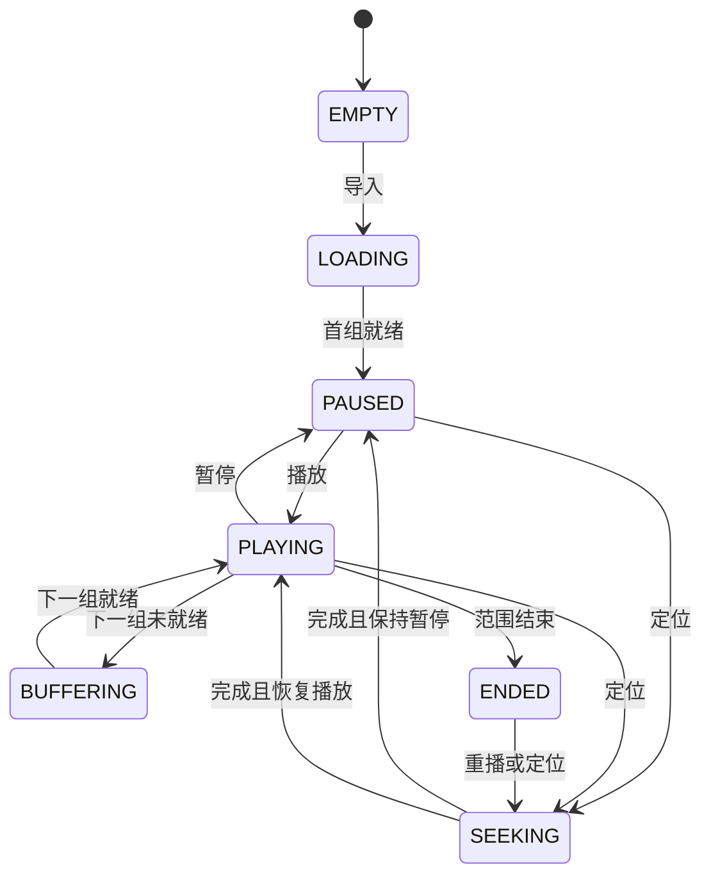

# 视频对比工具：Agent 开发实施计划

版本：v1.1  
日期：2026-09-23  
交付对象：负责实现、验证和打包本工具的编码 Agent  
项目：Vedio_Compare_Tool；Python 包名统一为 `video_compare`

> 目标：实现一个本地桌面视频主观对比工具，支持 1–6 路视频播放；2–6 路视频在同一时间位置对比、定位、逐帧查看，并对相同区域联动缩放与拖拽。以同步正确、画面可信、操作直接为首要目标。
>
> 本次交付是实施规格，不是已经实现的软件。Agent 按本计划顺序开发，先交付核心版，再完成增强版；不得用界面占位代替解码、同步和验收。

## 0. 编制依据与执行边界

本计划依据同目录 `Video_Compare_Tool_Requirements_v1.1.md`。该文件将先前确定的功能与本次三项新增/修订需求整理为独立需求文档；技术、数值和交互默认见第 2 节。

用户已经明确：使用 FFmpeg 管理视频；支持 1–6 个视频播放、2–6 个视频同步对比；输入时间或帧号定位；左右键的步进量可按帧/秒配置；拖动进度条定位；Ctrl + 鼠标滚轮缩放画面；可切换主题颜色。

上一轮需求还包含：不同分辨率、自适应网格、文件名；第二阶段变速、循环、100% 查看、最大化、重排、Offset、提醒、截图、Marker 和同步开关；第三阶段 A/B、分割线、冻结、Workspace、ROI 截图、快捷键自定义、全屏。

**不属于本轮核心范围：**音频播放与音频同步、视频导出与编码、转码工具、PSNR/SSIM/LPIPS/VMAF 等客观指标。测试脚本生成测试视频不属于产品的视频导出功能。

### 0.1 Agent 执行规则

1. 先阅读所在仓库的 `AGENTS.md` 和现有源码。如果已有实现，按本文补齐与重构，不无条件新建第二套应用。
2. 本文默认执行 **M0–M8：核心版与增强版**。M9 是第三阶段，保留完整设计和任务，不以做完它作为前两阶段交付的前提。
3. 每完成一个里程碑，交付可运行增量、对应测试结果及简短变更记录，然后继续下一里程碑。
4. 核心算法、异步边界和测试必须真实实现；不允许用固定帧、定时器假播放、随机测试结果或 TODO 伪装完成。
5. 缺少 Windows 环境时，可以完成跨平台源码和可运行验证；Windows 打包、DPI、真实 OpenGL 与性能项写成“待在 Windows 验证”，不能标为通过。
6. 遇到库 API 差异，先核对锁定版本并完成小实验；在 `docs/DECISIONS.md` 记录最小调整。保持本计划定义的外部行为。
7. 本计划不是要求多 Agent 并行。单 Agent 按依赖顺序执行即可。

## 1. 需求追踪矩阵

优先级定义：P0＝核心版必须；P1＝第二阶段；P2＝第三阶段。工程支撑项虽不直接出现在原需求中，但属于实现相应功能的必要工作。

| ID | 需求 | 优先级 | 实现落点 | 主要验收 |
|---|---|---|---|---|
| R01 | 1–6 路导入、播放、删除、替换；2–6 路同步比较 | P0 | AssetManager、文件列表 | A01 |
| R02 | 同步播放/暂停 | P0 | TransportController、FrameBarrier | A02、A16 |
| R03 | 公共进度条、拖动同步定位 | P0 | TimelineBar、seek generation | A03 |
| R04 | 输入时间或帧号同步定位 | P0 | InputParser、TimelineMapper | A04、A07 |
| R05 | 左右键可配置帧/秒步进 | P0 | CommandRouter、StepSpec | A05、A06 |
| R06 | Ctrl + 滚轮联动 Zoom，拖拽 Pan、ROI | P0 | ViewportController | A08、A09 |
| R07 | 不同分辨率对比 | P0 | display geometry、归一化坐标 | A08 |
| R08 | 自动 Grid、文件名显示 | P0 | CompareCanvas、PanelModel | A01 |
| R09 | 变速 | P1 | PlaybackClock | A12 |
| R10 | 区间循环 | P1 | LoopRange | A12 |
| R11 | 100% 像素查看 | P1 | PixelInspect 模式 | A10 |
| R12 | 单路最大化、顺序调整 | P1 | LayoutController | A11 |
| R13 | 每路 Offset | P1 | TimelineMapper | A07 |
| R14 | 帧率/尺寸/时长不一致提醒 | P1 | MetadataInspector | A07、A13 |
| R15 | 当前画面截图 | P1 | ScreenshotService | A14 |
| R16 | Marker | P1 | MarkerStore | A15 |
| R17 | 同步开关 | P1 | 时间联动/视图联动分别控制 | A11 |
| R18 | A/B 切换、分割线 | P2 | CompareMode | A20 |
| R19 | 单路冻结 | P2 | FrozenFrame | A20 |
| R20 | Workspace 保存/恢复 | P2 | WorkspaceRepository | A21 |
| R21 | ROI 截图 | P2 | ScreenshotService | A20 |
| R22 | 自定义快捷键、全屏 | P2 | ShortcutRegistry、WindowState | A20 |
| R23 | 跟随系统/浅色/深色外观与蓝/绿/紫/橙强调色切换、记忆 | P0 | ThemeController、Settings | A23 |
| E01 | PTS、VFR、长 GOP、B 帧正确处理 | P0 支撑 | FrameIndex、Decoder | A04–A07 |
| E02 | 拖动取消、旧结果隔离、有限缓存 | P0 支撑 | WorkerMailbox、FrameCache | A03、A16–A18 |
| E03 | 方向、色彩范围、错误可见 | P0 支撑 | DisplayPolicy、ErrorModel | A13、A19 |
| E04 | 可复现安装、打包与日志 | 发布支撑 | 工程配置、部署脚本 | A22 |

P0 的 ROI 指“框选相同区域并联动查看”，不包含截图导出。P0 已具备固定快捷键；P2 的快捷键是用户自定义。

## 2. 技术路线与默认决定

### 2.1 单一实现主线

**Python 3.11 + PySide6 Widgets + PyAV/FFmpeg 解码 + ffprobe 元信息 + 单个 QOpenGLWidget 对比画布。**

| 层级 | 选择 | 职责 |
|---|---|---|
| 桌面 UI | PySide6 Widgets | 文件列表、控件、快捷键、窗口 |
| 视频解码 | PyAV | 持有 FFmpeg container/stream，取得逐帧 PTS 和像素 |
| 文件信息 | ffprobe CLI | 容器、流、编码、旋转、色彩等元信息 |
| 画面渲染 | 一个 `CompareCanvas(QOpenGLWidget)` | 在一次绘制中显示整个同步帧组 |
| 无 OpenGL 回退 | 同接口的 QWidget/QPainter canvas | 功能回退，显示软件渲染状态 |
| 数组 | NumPy | RGB buffer、ROI 裁切、测试图 |
| 后台任务 | Python worker threads + Condition/mailbox | 每路解码串行，索引后台构建 |
| 测试 | pytest、pytest-qt | 时间映射、线程竞态、GUI 行为 |
| 打包 | pyside6-deploy | Windows 文件夹式分发，M8 验证实际产物 |

PyAV 是 FFmpeg 的 Python 绑定，可访问容器、流、包和帧，符合“以 FFmpeg 管理视频”的要求 [S1]。`ffmpeg.exe` 主要供测试素材生成和诊断使用；实际连续解码不需要每帧启动一个命令行进程。`ffprobe` 提供机器可读流信息 [S2]。

不要使用 6 个独立播放器各自计时。不要使用 OpenCV `VideoCapture` 作为核心定位后端。不要把浏览器网页作为本计划的默认交付形态。以上是本项目的工程选择，不是对这些工具一般能力的评价。

### 2.2 工程默认值

| 决策 | 本计划默认 | 说明 |
|---|---|---|
| 主平台 | Windows 10/11 x64 | 工程假设；保持源码跨平台，不承诺未测平台 |
| 界面语言 | 简体中文 | 内部类型和函数名英文 |
| 默认主题 | 跟随系统 + 蓝色强调色 | 外观与强调色独立切换并记忆；只影响 UI |
| 输入 | 本地视频文件 | 首期不接网络流、图片序列、摄像头 |
| 默认同步 | 时间同步 | 以真实 presentation timestamp 映射 |
| 帧号 | UI 从 1 开始；内部从 0 开始 | 全界面保持一致 |
| 时间原点 | 各路第一张可显示帧为本地 0 | 保存原始 PTS，不丢失源时间信息 |
| 基准视频 | 首个成功导入的视频 | 可显式切换；重排不改变基准 |
| 播放优先级 | 严格同步、允许整体变慢 | 不允许一路落后仍宣称同步 |
| 播放范围 | 所有参与路的公共有效区间 | P0/P1 固定此策略，长度不一时在公共末端停止 |
| 默认视图 | 同区域联动、Fit | 同一归一化区域；保持宽高比 |
| 默认步进 | 1 帧 | 可改 1/5/10/30 帧或自定义整数 |
| 秒步进 | 0.1/0.5/1/5 秒或自定义正数 | 接受毫秒精度输入 |
| 倍速 | 1× | P1 支持 0.25/0.5/1/2/4× |
| 解码 | CPU 软件解码 | 硬件解码仅在测出瓶颈后作为后续优化 |
| 画质 | 原分辨率解码，SDR RGB8 预览 | 不自动降采样视频，不自动锐化 |
| 缓存 | 全局 RGB 缓存默认 512 MiB | 用户可配置；不是每路 512 MiB |
| 网络 | 正常使用不依赖网络 | 不上传视频，不运行时下载依赖 |

禁止凭经验填写“支持所有编码”或“6 路 4K 实时”。解码能力和性能以锁定构建与实测报告为准。

### 2.3 M0 固定依赖，而非猜测版本

创建独立环境；验证 PySide6、PyAV、NumPy、部署工具在 Python 3.11 上的组合。记录实际 `av.__version__`、`av.library_versions`、Qt/PySide6 版本、ffprobe/ffmpeg 版本及 build configuration。PyAV wheel 链接的 FFmpeg 库可能与命令行 FFmpeg 不同，必须分别记录，不把二者混为一套。

锁定完整依赖版本与可复现安装命令。本文不把搜索结果中的 “stable/latest” 当作固定版本。API 以安装后的小实验和对应版本官方文档为准。

## 3. 用户界面与交互合同

### 3.1 主窗口

| 区域 | 必须显示/支持 |
|---|---|
| 顶部工具栏 | 添加文件、播放/暂停、同步模式、基准视频、Fit、ROI、视图联动 |
| 中央对比区 | 1–6 格，文件名/别名、当前本地帧号与时间、基准标识、错误/等待状态 |
| 底部时间栏 | 统一进度条、当前全局时间、时间输入、帧号输入、步进单位与数值 |
| 文件侧栏 | 视频列表、顺序、删除/替换、元信息；P1 Offset 与参与开关 |
| 状态栏 | 索引状态、实际速度、缓存占用；错误摘要可展开 |
| 主题入口 | 外观：跟随系统/浅色/深色；强调色：蓝/绿/紫/橙；即时生效、重启后保留 |

文件名过长可以省略，中间或末尾省略必须有完整 tooltip。当前选中视频用边框表示；选中与基准是两种状态。

默认网格按“行 × 列”：1 路为 1×1，2 路为 1×2，3 路为 1×3，4 路为 2×2，5/6 路为 2×3。1 路可完整播放、定位、步进与查看；2–6 路执行同步比较。5 路的空格显示为空，不重复某一路。各格内容区尺寸一致，标题高度统一。

添加第 7 路时提示数量上限，不静默替换已有视频。重复添加同一文件允许，用不同 `asset_id` 表示。拖入多文件时按输入顺序追加，超出 6 路的项目逐项列出未导入原因。

### 3.2 默认快捷键与鼠标操作

| 操作 | 行为 |
|---|---|
| Space | 播放/暂停同步组 |
| ← / → | 先暂停，再按当前步进配置定位 |
| Home / End | 当前比较范围起点/最后有效显示位置 |
| Ctrl+O | 添加视频 |
| Ctrl + 鼠标滚轮 | 指针位于视频有效画面时，向上围绕指针缩放、向下缩小；未按 Ctrl 的滚轮不缩放画面 |
| 左键拖动 | 平移当前画面；开启联动时传播视图状态 |
| ROI 工具下左键框选 | 建立归一化 ROI，联动放大该区域 |
| F | Fit；重置缩放与中心 |
| Esc | 取消未完成框选；P1 退出最大化；P2 退出全屏 |
| 双击面板 | P1 单路最大化/恢复，保持视图状态 |
| M | P1 在当前已提交位置添加 Marker |
| I / O | P1 设置循环区间起点/终点 |

输入框、下拉框或文本编辑器获得焦点时，左右键、Space、Home/End 必须保留控件的正常编辑行为。只有画布/全局运输控件焦点域接收这些播放命令。弹出模态对话框时也不得误触发播放。

长按方向键：累加用户每次有效按键的目标位置，但解码请求只保留最新目标。例如连续按 10 次 →、每次 1 帧，最终是 +10 帧，不是 +1 帧；中间过期请求可以合并。

### 3.3 输入解析

时间接受 `SS[.mmm]`、`MM:SS[.mmm]`、`HH:MM:SS[.mmm]`。界面明确写“全局时间”；它以基准视频本地零点为坐标，公共区间左端不一定为 0。非法格式、负值、NaN/Inf、空字符串都不执行定位并显示字段错误。

帧号字段明确写“基准视频帧号（从 1 开始）”。超过已确认范围时提示并提供有效范围；不悄悄把输入改成另一帧。索引未覆盖目标时进入可取消的等待，不能给估计帧号贴“精确”标签。

拖进度条或输入新的位置后必须显式刷新所有参与视频。拖动前正在播放的，松开并完成最终精确定位后继续播放；拖动前暂停的，保持暂停。方向键和时间/帧号回车定位默认保持暂停，便于仔细查看。

## 4. 时间与帧同步：必须先定义再编码

### 4.1 数据语义

`i` 为视频，`k` 为按显示顺序排列的内部帧序号，`r` 为基准视频。

```text
P_i(k) = 该帧的原始 presentation timestamp，保留整数 pts 与有理数 time_base
T_i(k) = P_i(k) * time_base_i - P_i(0) * time_base_i
D_i    = 最后一帧的结束时刻，不是容器中音频的结束时刻
G      = 全局时间，单位秒，计算使用 Fraction/有理数
o_i    = 每路时间 Offset，基准路固定 o_r = 0
q_i    = 每路帧 Offset，基准路固定 q_r = 0
```

时间比较使用原始有理数；显示才转为毫秒文本。禁止靠累加 `1/float(fps)` 维护时间。`avg_frame_rate`、`r_frame_rate` 和容器 `nb_frames` 是提示信息，不是精确索引。缺失总帧数时显示“索引中/未知”。

### 4.2 模式 A：时间同步，默认

每一路目标本地时间：`L_i = G + o_i`。

选择覆盖该时间的帧：`k_i = max{k : T_i(k) <= L_i}`，并要求 `L_i < D_i`。一般帧的显示区间为 `[T_i(k), T_i(k+1))`；最后一帧为 `[T_i(last), D_i)`。

不使用“最近帧”默认映射，以免提前显示未来帧。同一时间在低帧率视频上重复显示同一帧是正常现象。禁止为了同帧号而把 24 FPS 和 30 FPS 当作相同时间。

**例子：**基准 30 FPS，另一视频 24 FPS，都从 0 开始；`G=0.1s` 时，基准内部帧 3、UI 帧 4；另一视频内部帧 2、UI 帧 3。两路对应同一时刻附近的真实曝光，UI 应分别显示各自的帧号。

时间同步下输入基准帧号 N：令 `G=T_r(N-1)`，再映射其他路。

时间同步下“前进 n 帧”：从当前已选中的基准帧 k 出发，令 `G=T_r(k+n)`。后退同理。若前一次按键的定位尚未完成，必须从待执行的请求帧号继续累加，不能再次从旧显示帧起算。它表示前进基准视频 n 个显示帧，不保证其他路也恰好增加 n 帧。

时间同步下“前进 x 秒”：令 `G_new = G_requested + x`，不要先吸附到基准帧再累计。这样小于帧间隔的多次步进仍会累积时间；帧标签可以暂时不变。

### 4.3 模式 B：帧号同步

主位置为基准内部帧号 K，每路选 `k_i = K + q_i`。该模式用于相同帧序列被不同 FPS 元数据封装，或逐帧处理结果的对应检查。

不同 FPS 时，帧号同步不承诺真实时间同步，界面必须持续显示模式。播放节奏取基准相邻 PTS 的间隔；若基准 PTS 不可用，则用户明确选择标记为“合成时间轴”的速率后才可播放。

帧模式输入时间或按秒步进：维护基准请求时间游标，将其按 4.2 的 floor 规则映射到基准 K，再使用 q_i。每次帧步进则把时间游标重新设置为 `T_r(K)`。UI 显示实际帧时刻，另保留请求时间，防止亚帧秒步进被吞掉。

切换模式时先暂停，以当前显示的基准帧为锚重新定位全部视频，不能在播放中静默改变对应关系。

### 4.4 Offset 的正负方向与有效范围

P0 以所有 Offset＝0 实现，但模型和接口预留字段。P1 开放编辑。

时间 Offset `+0.200s` 表示“在全局 G 时显示该路 G+0.200s 的画面”，即沿该路往后取内容。若 B 比 A 多 0.2 秒片头，为 B 设置 +0.2 秒。帧 Offset `+5` 表示全局 K 对应 B 的 K+5。

时间/帧 Offset 分别保存，随模式启用对应字段，禁止对 VFR 用平均 FPS 自动互转。Offset 改动是一项原子操作：暂停、失效旧请求、重算范围、统一定位。对齐辅助按钮“将各路当前帧设为同一时刻”通过各路当前 PTS 求 o_i；帧模式通过序号求 q_i。

默认公共范围：

```text
时间模式：[ max_i(-o_i), min_i(D_i-o_i) )
帧模式：  max_i(-q_i) <= K <= min_i(N_i-1-q_i)
```

若交集为空，禁用组播放并显示是哪几路不重叠，保留用户修正 Offset 的入口。

方向键在边界采用停止/截断到最后可达位置的规则，不自动循环；循环只影响播放。直接输入的目标若不在公共范围，显示字段错误和有效范围，不静默改值。所有内部 seek 入口都由同一个 range validator 检查，不能只让进度条限制范围而允许快捷键越界。

P0/P1 只实现公共有效区间，不实现“最长视频继续、其他视频保持末帧”的策略。长度不一的文件仍可正常比较其重叠片段；文件列表显示被排除的片头/片尾范围。这样所有正常参与路在每个提交时刻都有真实有效帧。

基准切换：保持当前实际对应帧。时间模式新基准为 j 时，`G'=G+o_j`、`o_i'=o_i-o_j`；帧模式相同规则作用于 K/q。Marker、循环区间也按同样变换更新。只改变选中面板或重排不会切换基准。

### 4.5 结尾、循环与暂停

公共范围为半开区间；End 键跳最后一个有效可显示事件，不能定位到无帧的 D。结束后停留在最后一个同步帧组并进入 ENDED；再次播放默认从范围起点开始。

P1 循环区间内部表示 `[A,B)`。用户按 O 时，将当前基准帧的结束时刻作为 B，使 UI 所选末帧也播放一次。循环播放完最后一个组后重新定位 A；不先短暂显示 B 外的帧。循环开关、边界和实际包含的帧范围必须可见。

## 5. 精确定位、索引与解码

### 5.1 元信息探测

通过参数数组调用 `ffprobe -v error -show_format -show_streams -of json <absolute_path>`，不用 shell 拼接。后台读取并设置超时、取消、stderr 上限。选择默认非封面视频流，多个视频流时允许选择并记录真实 `stream.index`，不能默认永远是 stream 0。

提取：编码尺寸、显示旋转/镜像、SAR/DAR、codec、pix_fmt、bit depth、time_base、帧率提示、duration 提示、stream start_time、色彩矩阵/范围/primaries/transfer。PyAV 实际解码的流必须与探测选择一致。

文件指纹包括规范路径、size、mtime_ns、首尾小块内容 hash、stream index、索引 schema 和解码器版本签名。指纹变化使索引/缓存失效；这是缓存校验机制，不宣称全文件内容认证。

### 5.2 FrameIndex

按解码器输出的显示顺序建立精确索引；包含 B 帧并在 EOF flush。每项至少保存：

```python
FrameIndexEntry(
    ordinal: int,              # display-order, 0 based
    pts: int | None,           # original stream/frame presentation timestamp
    time_base_num: int,
    time_base_den: int,
    duration_ticks: int | None,
    is_keyframe: bool,
    pts_occurrence: int,       # repeated PTS disambiguation within decoded order
    timing_quality: str,      # actual / inferred_duration / unavailable
)
```

索引构建只保留元数据，不保留所有 RGB 像素。使用 SQLite 表或紧凑数组落盘；默认 SQLite，分块事务写入。索引状态为 `unknown/building/partial/complete/failed`。

首帧可显示后立即开放时间预览；后台顺序索引，不能等整个长视频扫完才打开窗口。精确帧号跳转只在目标被索引覆盖后完成；超出覆盖范围显示进度并继续构建。时间预览尚无可信全局 ordinal 时显示帧号“索引中”，不编造序号。一次最多一个后台索引任务，前台定位优先，防止导入 6 路立即进行 12 路争抢解码。

**实现简化原则：**初版允许长视频首次建立完整索引耗时；必须可取消、可复用、可播放已覆盖区域。不要以“加快打开”为理由使用 `frame_index = time * avg_fps`。

### 5.3 seek 的准确含义

PyAV 的 `seek` 定位到附近关键帧；官方建议回到此前关键帧，再向前解码至目标 [S3]。因此：

1. 命中准确帧缓存，直接返回。
2. 目标在当前解码游标后方且距离较近，继续顺序解码。
3. 其他情况找到目标之前可用的随机访问锚点，调用 `container.seek(raw_pts, stream=stream, backward=True, any_frame=False)`。
4. 丢弃旧 decoder iterator/应用层队列，依照锁定 PyAV 版本处理 seek 后缓冲清理。
5. 逐帧解码，使用原始 PTS、索引及重复序号判定帧身份；不能把 seek 后第一帧当成目标。
6. 返回目标 frame ID，同时返回真实 PTS、ordinal 和命中方式供验证。
7. 若锚点解码无法对应索引，例如 open GOP 或 seek 越过目标，退到更早锚点；仍不一致时从文件开头顺序解码建立确定身份。慢可以被提示，错帧不能被隐藏。

`stream` 参数存在时，seek 单位是该流 `time_base`；不是秒、毫秒，也不是固定微秒。示例：time_base=1/90000，原始目标 PTS=180000，传入 180000。时间归零只是 UI 的坐标变换，实际 seek 必须恢复原始时间原点。

### 5.4 后退一帧

优先用向后帧缓存。未命中时回到前一个可解码关键帧，正向解码到目标，并缓存临近帧。禁止把压缩码流倒序读当作逐帧倒放。首期没有连续反向播放，只有后退定位。

邻近缓存应同时有少量前向预取和已看帧；不能每按一次左键都无条件从文件开头解码。

### 5.5 异常时间戳

相同 PTS 的帧使用显示序号区分；时间映射选择该时间戳的最后一个显示帧，帧模式仍可逐一访问。PTS 下降、缺失等使可靠时间轴不可建立时，显示“时间戳异常”，不宣称精确时间同步。允许用已建立的显示序号进入帧模式；若需要播放，则由用户显式选合成节奏。

最后一帧时长优先采用可靠 frame duration，其次采用可靠的流结束时刻，再次使用最近正常帧间隔估计，并标记 `inferred_duration`。估计只影响最后帧停留和区间末端，不能改写已有帧的 PTS。

不支持的交错场、损坏流、运行中分辨率变化等必须检测。v1 对运行中变尺寸暂停并说明，不能把旧纹理尺寸套到新帧；后续扩展须另验收。

## 6. 播放调度与异步模型

### 6.1 架构



主线程持有 UI、控制器状态、当前帧组和 OpenGL 上下文。各路 worker 独占自己的 PyAV container/codec。索引任务有独立 container；不与播放 worker 共用一个读游标。

worker 通过线程安全的有界 mailbox 收命令，通过 Qt signal bridge 向主线程发结果。bridge 在主线程创建，结果连接使用 queued connection。worker 不直接修改 QWidget、QPixmap 或 OpenGL 纹理。Qt 的跨线程信号机制与图形上下文限制分别参考 [S4][S5]。

### 6.2 两种 ID，不混用

```text
session_epoch：文件添加/删除/替换、关闭工程时改变
generation：seek、scrub、模式/Offset/参与组/基准改变时递增
request_seq：同一 generation 内每个播放/预取请求的唯一序号
group_id = (session_epoch, generation, request_seq)
```

正常顺序播放不要每一帧都重置 generation，否则预取缓存永远失效。UI 缩放只更新 `view_revision`，不改变视频帧缓存或解码游标。

结果只有在 asset identity、session_epoch、generation 和待提交 group_id 都匹配时才能上屏。旧请求即使晚到也直接丢弃；丢弃之后释放其 buffer 所有权。

### 6.3 FrameBarrier：一组准备齐再显示

`PendingFrameGroup` 在创建时固定本组参与路、各路目标 frame ID 与边界状态。每路结果到齐且校验正确后生成不可变 `FrameGroupSnapshot`，一次交给画布。

单个 OpenGL 画布在一帧绘制中显示所有 pane。新组先上传到 staging textures，全部成功后再交换 front/staging；不边上传边替换单路前台纹理。CPU 回退画布也在一次 paintEvent 中使用同一个快照。

这保证的是应用层同一显示快照，不承诺操作系统扫描输出的每个物理像素完全同时变化。

一条路等待时其他路保持上一完整帧组，显示“同步等待”。一条路解码失败则暂停组并展示具体错误，不静默从参与组移除。用户显式移除失败路后重新建组。

### 6.4 播放时钟与不同帧率

使用 `time.monotonic_ns()` 建立播放时钟；QTimer 只负责唤醒检查，不能用 timer 触发次数当视频时间。暂停、变速、缓冲恢复时重新锚定时钟，避免把缓冲耗时补偿成突然快进。

**时间同步的显示事件：**取所有参与路的 `T_i(k)-o_i` 的有序并集，并裁剪到有效区间。每个事件只改变该时刻应该变化的视频，其他路复用已有帧。这样基准为 24 FPS、另一路为 60 FPS 时，也不会强制把后者限制为每秒 24 次变化。

**帧号同步的显示事件：**基准逐帧前进 K，事件间隔取基准相邻帧时间。其他路取 K+q_i。

P0/P1 默认严格模式：按事件顺序提交，不跳过尚未显示的事件；准备不足时整体等待，恢复时从该事件继续。记录实际倍率；可以比设定倍率慢，不能一路快一路慢。播放链路须有前向预取，避免在每一帧显示后才开始请求下一帧。

如果今后提供“实时优先”，仅允许跳过完整显示事件，所有路共同跳到同一目标时间；此模式不属于前两阶段的必须项。

### 6.5 seek 与拖动流程

```text
开始拖动：保存 was_playing，暂停时钟，进入 SCRUBBING
拖动中：更新请求时间；最多每 50ms 发送一次最新预览请求
        新 generation 取代旧 generation，不排队执行所有历史位置
        预览仍按真实 PTS 选帧；若未就绪保留上一完整组并显示等待
松开：取消节流，立即提交最后目标的最终精确请求，进入 SEEKING
完成：校验所有目标帧 -> 原子上屏 -> 恢复原来的播放/暂停意图
```

“50ms”是工程初始节流参数，可以依据实测调整；不代表保证 50ms 内解码完成。预览不使用错误帧冒充目标帧。

暂停过程中若已有未来播放组在飞行，丢弃其显示资格，以最后实际显示组为暂停位置。新 seek 打断旧 seek 时只接受最新 generation。播放/暂停意图与解码状态分别保存，避免 seek 结束后意外自动播放。

### 6.6 状态机



`SCRUBBING` 作为 SEEKING 的交互子状态；任何可运行状态遇到单路错误都暂停并挂上 ErrorModel。EMPTY/LOADING 下禁止无意义播放。关闭过程进入独立 CLOSING 状态，拒绝新任务。

### 6.7 缓存和资源上限

缓存按实际字节做全局 LRU，key 至少包含 asset fingerprint、stream、frame ordinal、显示转换配置。相同文件重复导入时可以共享不可变像素缓存，解码游标仍各自独立。

RGB8 内存估算：1080p 一帧约 5.93 MiB，6 路×8 帧约 285 MiB；4K 一帧约 23.73 MiB，6 路×8 帧约 1.11 GiB。因此禁止写死“每路缓存 100 帧”。

缓存预算包含已提交和待提交的 CPU RGB buffers；这些帧被 pin，不能被 LRU 提前释放。只有预算足够才增加预取。最低需要容纳当前组和下一个组；512 MiB 对 6 路 4K 两组 RGB8 已需约 285 MiB，余量用于少量历史帧。解码器内部 YUV 缓冲、Python 对象、索引、GPU front/staging textures 独立计入诊断，不谎称总进程内存只占缓存预算。

每路至多一个正在执行的 foreground 请求和一个待替换的 latest 请求；预取队列有界。完成结果也走有界队列/限流通知，不能把每个预取结果无上限塞进 Qt 事件队列。

解码线程数受全局预算管理，建议从总逻辑 CPU 的一半开始分配，单路至少 1，M0 测后固定。6 路不能各自无条件开满 CPU 核。后台索引在交互 seek/缓冲时让出资源。

退出顺序：停止接收命令 -> 取消 generation -> 通知 worker -> worker 在包/帧边界停止并关闭自身 container -> 结束探测进程 -> 主线程销毁纹理和窗口。禁止跨线程强关正在解码的 container、直接强杀线程或阻塞 UI 无限 join。用异步关闭进度和明确超时错误处理不可恢复任务。

## 7. 视图联动：不同分辨率下看同一块内容

### 7.1 四套坐标

1. 编码像素坐标：文件内实际采样宽高。
2. 显示坐标：应用旋转/镜像与 SAR 后的正确画面方向和比例。
3. 归一化内容坐标 `(u,v)`：显示画面左上为 `(0,0)`，右下为 `(1,1)`。
4. Qt 逻辑像素和 framebuffer 像素：用 devicePixelRatio 关联。

所有 ROI、联动中心在第 3 套坐标保存；渲染、鼠标映射统一调用同一个变换模块。不得把窗格的鼠标像素位移直接复制给另一窗格。

归一化对应假设各视频视野和内容构图相同。缩放倍数不同可以正确联动；内容被裁掉、视角不同、镜头抖动不同不会自动配准。v1 提示差异并允许解除视图联动，不加入光流或 AI 对齐。

### 7.2 默认“同区域”模式

共享状态为 `ViewRegion(center_u, center_v, width_u, height_v)`。Fit 时中心 `(0.5,0.5)`、区域宽高 `(1,1)`。

每个窗格把该归一化矩形对应的真实画面区域等比放进内容区；黑边不属于图像。设某视频显示尺寸为 Dw×Dh，内容区为 Pw×Ph：

```text
s = min(Pw / (width_u * Dw), Ph / (height_v * Dh))
screen_x = panel_center_x + s * Dw * (u - center_u)
screen_y = panel_center_y + s * Dh * (v - center_v)
```

用居中的 `s*width_u*Dw` × `s*height_v*Dh` 矩形裁剪可见内容，确保每个窗格看到完全相同的归一化区域；剩余部分为黑边。宽高比不同的文件不拉伸填满。

鼠标命中检测先排除标题和黑边。**只有按住 Ctrl 的滚轮**触发画面缩放；向上放大、向下缩小，普通滚轮保留其所在控件行为。缩放以鼠标下的 `(u,v)` 为锚：宽高除以缩放因子 f，中心变为 `p - (p-center)/f`，随后统一进行区域边界约束。默认每格滚轮 f=1.15，缩放上限 64× Fit，不能形成零/负区域。

拖动 `Δx,Δy`：`center_u -= Δx/(s*Dw)`，`center_v -= Δy/(s*Dh)`，只由当前操作窗格计算一次，随后广播共享 region。边界 clamp 在共享状态进行，不能各路独立 clamp 导致漂移。

拖动或滚轮都不重新解码；只更新 view_revision 与重绘。视频播放过程中可操作视图。

### 7.3 ROI

框选区域由屏幕坐标逆变换为归一化矩形，剔除黑边，clip 到 `[0,1]²`；小于 4×4 逻辑像素的误触不生效。一次框选完成，所有联动窗格设置同一个 region。提供“取消框选”和“重置 Fit”。

ROI 是固定图像位置，不跟踪人脸或物体运动。播放时内容可以移出 ROI，这不是同步故障。

### 7.4 100% 原生像素模式，P1

“同区域”与“每路 100% 像素”对不同分辨率通常不能同时满足，所以界面提供明确的查看模式切换：

| 模式 | 保证 | 不能同时保证 |
|---|---|---|
| 同区域 | 所有路显示同一归一化 ROI | 所有路同时一个源像素等于一个屏幕像素 |
| 原生像素 | 100% 时一源采样像素对应一 framebuffer 像素 | 不同分辨率的可见区域面积相同 |

原生像素模式仍联动归一化中心，并联动相对像素倍率；每路独立计算可见范围。100% 使用 `logical_scale=1/devicePixelRatio`，不能把一个 Qt 逻辑像素误当一个物理显示像素 [S6]。OS 后续合成可能影响最终屏幕采样，因此验收以应用 framebuffer 和已知显示设置为准。

对非方形像素 SAR，原生检查按存储采样像素显示并注明“像素检查：忽略 SAR”；Fit/同区域模式仍按正确 SAR 显示。旋转/镜像后像素对应关系保留。

100% 和大于 100% 默认 nearest；Fit 缩小默认 bilinear。用户可以切换采样方式，所有联动 pane 一致，并显示状态。不得把放大后的双线性平滑当作原生细节。

### 7.5 视图开关与布局

P1 提供两个独立概念：

- 时间参与开关：该路暂不参加播放组，保留最后显示帧并显示“已脱离同步”；不独立后台继续播放。重新加入时定位到组的当前位置。
- 视图联动开关：关闭后每路保存自己的 region；重新开启，以当前选中路为共享视图源，显式刷新其余路。

不把“脱离时间同步”与 P2 的“冻结对比帧”混同。前者属于参与管理；后者保留指定帧供持续对照。

最大化只改变布局，不改变当前帧、基准、Offset 或 view region。被隐藏的参与路继续参加同步组；恢复网格时不能突然跳到另一位置。顺序以稳定 asset_id 存储，拖动文件条目重排不会重建解码器。

## 8. 显示质量与输入兼容性

### 8.1 v1 明确支持边界

必须测试的组合：MP4/MOV/MKV 容器中的 H.264、HEVC，以及用于测试的无损 FFV1；实际可用编码取决于安装的 FFmpeg 构建。扩展名仅用于文件筛选，是否支持以实际探测和解码为准。

主验收内容为逐行扫描、SDR、常见 BT.709/BT.601 矩阵、limited/full range。10-bit SDR 可以转换成 RGB8 预览，但面板必须标注“源 10-bit，当前 8-bit 预览”，不能承诺原生 10-bit 显示。

PQ/HLG/BT.2020 HDR：识别并提示 v1 尚未实现可信 HDR 显示，允许取消该路或只查看元信息；不得当普通 SDR 直接展示并让用户据此评估颜色/亮度。HDR tone mapping 是独立后续需求，不夹带进核心版。

### 8.2 统一转换路径

所有 pane 使用相同 `DisplayPolicy`：按输入元信息确定 YUV 矩阵与 full/limited range，经 FFmpeg/libswscale 转为 RGB8。PyAV `VideoReformatter` 及相关参数以锁定版本为准，参考 [S7]。M0 用已知色块验证显式设置确实生效；缺少参数支持时使用 PyAV filter graph 封装同一 FFmpeg 转换，而不是悄悄忽略。

不添加亮度、锐化、对比度、降噪、自动增强。不因为网格太小而提前压缩 RGB 或换用有损预览文件。显示缩放与源解码分开。

元信息缺失时允许预设：HD 默认 BT.709 矩阵、SD 默认 BT.601；range 按格式提示再按 documented fallback 处理。面板显示“色彩参数推定”，支持覆盖并记录。不得把推定包装成源文件事实。

v1 提供一致的 SDR 数值预览流程，不承诺经过 ICC 校准或专业色彩参考监视器级精度。OpenGL 与 QPainter 的转换路径要一致，禁止额外重复 gamma/range 转换。

### 8.3 方向与比例

从显示矩阵/rotation 元信息恢复 0/90/180/270 度与必要镜像，统一应用一次。验证手机竖屏 MOV/MP4，不同时让解码器和 shader 各旋转一次。对无法解析的任意显示矩阵明确报不支持，并保留诊断信息。

颜色转换后的 RGB 保持原采样分辨率；方向和 SAR 优先作为渲染矩阵处理，避免无意义重采样。截图导出根据截图类型决定是否应用显示方向。

## 9. 数据模型和模块接口

### 9.1 核心模型

以下是接口合同，不要求逐字复制为最终实现；字段语义不可丢失。

```python
@dataclass(frozen=True)
class AssetInfo:
    asset_id: str
    path: Path
    fingerprint: str
    stream_index: int
    coded_width: int
    coded_height: int
    time_base: Fraction
    display_transform: DisplayTransform
    color_info: ColorInfo

@dataclass(frozen=True)
class TimelineSpec:
    mode: Literal['time', 'frame']
    reference_id: str
    participants: tuple[str, ...]
    time_offsets: dict[str, Fraction]
    frame_offsets: dict[str, int]
    end_policy: Literal['intersection']

@dataclass(frozen=True)
class FrameRequest:
    session_epoch: int
    generation: int
    request_seq: int
    asset_id: str
    target_ordinal: int | None
    target_local_time: Fraction | None
    purpose: Literal['present', 'scrub', 'prefetch', 'snapshot']

@dataclass(frozen=True)
class DecodedFrame:
    asset_id: str
    ordinal: int | None
    pts: int | None
    time_base: Fraction
    local_time: Fraction | None
    rgb: np.ndarray            # H,W,3 uint8；独占/共享只读所有权
    color_policy_id: str
    timing_quality: str

@dataclass(frozen=True)
class FrameGroupSnapshot:
    group_id: tuple[int, int, int]
    requested_global_time: Fraction
    reference_ordinal: int | None
    frames: dict[str, DecodedFrame]
    boundary_states: dict[str, str]
    mapping_revision: int
```

Python `frozen=True` 不会自动冻结 dict/ndarray；实际实现需使用 immutable mapping 或 copy-on-create，并把 pixel buffer 设为只读，确保 worker 不复用/覆写当前显示数据。

### 9.2 必需接口

```python
class FrameIndexRepository:
    def lookup_time(self, asset_id, local_time: Fraction) -> IndexLookup: ...
    def lookup_ordinal(self, asset_id, ordinal: int) -> IndexLookup: ...
    def ensure_coverage(self, asset_id, target, priority) -> JobHandle: ...

class TimelineMapper:
    def map_position(self, position, spec: TimelineSpec) -> GroupTargets: ...
    def next_event(self, committed_position, spec) -> TimelineEvent: ...
    def valid_range(self, spec) -> TimelineRange: ...

class DecoderWorker:
    def submit_latest(self, request: FrameRequest) -> None: ...
    def prefetch(self, requests) -> None: ...
    def cancel_before(self, generation: int) -> None: ...
    def request_close(self) -> None: ...

class TransportController:
    def play(self) -> None: ...
    def pause(self) -> None: ...
    def seek_time(self, target: Fraction, resume: bool = False) -> None: ...
    def seek_reference_frame(self, ui_frame: int) -> None: ...
    def step(self, direction: int, amount, unit: str) -> None: ...
    def set_timeline_spec(self, spec: TimelineSpec) -> None: ...

class ViewportController:
    def zoom_at(self, panel_id, point_logical, factor) -> None: ...
    def pan(self, panel_id, delta_logical) -> None: ...
    def set_roi(self, panel_id, rect_logical) -> None: ...
    def reset_fit(self) -> None: ...

class CompareCanvas:
    def submit_group(self, snapshot: FrameGroupSnapshot) -> None: ...
    def set_view_state(self, state) -> None: ...
    def set_layout(self, ordered_asset_ids, mode) -> None: ...
```

`IndexLookup` 明确区分 hit、needs_index、out_of_range、invalid_timing，不以 None 表示所有情况。`JobHandle` 必须支持取消和进度。

### 9.3 建议目录

| 路径 | 内容 |
|---|---|
| `pyproject.toml`、lockfile | 依赖、启动入口、开发工具 |
| `src/video_compare/app.py`、`__main__.py` | 应用组装和启动 |
| `src/video_compare/domain/models.py` | 数据模型和枚举 |
| `src/video_compare/domain/timeline.py` | 纯时间映射、范围、Offset |
| `src/video_compare/domain/viewport.py` | 纯坐标变换、ROI |
| `src/video_compare/media/probe.py` | ffprobe 封装 |
| `src/video_compare/media/index.py` | 索引构建与仓库 |
| `src/video_compare/media/decoder.py` | PyAV 精确解码 |
| `src/video_compare/media/workers.py` | 有界 mailbox、取消、生命周期 |
| `src/video_compare/media/cache.py` | 全局字节 LRU |
| `src/video_compare/media/color.py` | 显示转换与能力检测 |
| `src/video_compare/controllers/transport.py` | 时钟、状态机、FrameBarrier |
| `src/video_compare/controllers/viewport.py` | UI 手势转换 |
| `src/video_compare/ui/main_window.py` | 控件与布局 |
| `src/video_compare/ui/canvas_gl.py` | 单画布 GPU 渲染 |
| `src/video_compare/ui/canvas_software.py` | 同接口回退 |
| `src/video_compare/ui/timeline_bar.py` | 进度条、输入、Marker |
| `src/video_compare/services/screenshots.py` | P1 截图 |
| `src/video_compare/services/settings.py` | 用户偏好 |
| `src/video_compare/services/workspaces.py` | P2 工作区 |
| `tests/unit/`、`tests/integration/`、`tests/gui/` | 对应测试层 |
| `tools/generate_fixtures.py` | 生成可核对测试素材 |
| `tools/benchmark_playback.py` | 可重复性能场景 |
| `scripts/build_windows.ps1` | Windows 构建入口 |
| `docs/`、`reports/` | 决策、说明、结果 |

不把所有功能堆进 MainWindow；domain 模块不依赖 QWidget、OpenGL 或实际解码文件，便于直接测试。

## 10. P1 功能的具体实现边界

### 10.1 变速与循环

变速只改变全局媒体时钟与真实时间的比例，不改变 PTS、Offset、帧索引和各路对应关系。变速时以当前已显示媒体位置重新锚定。0.25× 通过更久保持原帧实现，不生成插值帧；4× 在严格模式下可能达不到设定速度，要显示实测速度。

循环范围的编辑需要验证 A<B、位于当前公共范围，至少包含一个有效事件。改变 Offset/参与组/基准导致循环失效时，关闭循环并提示，不能保留不可达边界。

### 10.2 Marker

保存：marker_id、全局时间、基准帧号、当前模式、标题、可选备注。以已经显示的快照创建，不能使用尚在 seek 的请求时间。点击 Marker 后按当前时间模式重新定位；基准切换时按第 4.4 节变换。

P1 Marker 在当前会话有效；P2 随 Workspace 保存。退出前如果存在未保存 Marker，界面说明本阶段的会话性质，不伪装已经持久保存。

### 10.3 截图

P1 提供两种明确菜单项：

1. **保存当前对比视图 PNG**：当前同步组、布局、ROI 与标签构成的合成图。分辨率以当前内容画布 framebuffer 为准，记录 DPI。不是截取整个桌面。
2. **保存各路当前原尺寸帧 PNG**：使用同一不可变 FrameGroupSnapshot 中每一路的 RGB8 buffer，应用旋转/镜像；不把屏幕缩小图放大回来。对 SAR 非 1 的源，保留采样网格并在旁注明显示比例。

点击时冻结一个 snapshot 引用，不要求暂停视频。保存必须使用这个 snapshot，不能后台重新抓取已经前进的某一路。合成视图同时固定当前 layout、view_revision 和 framebuffer 尺寸；由主线程在对应帧组仍是 front group 时捕获，或按这些固定状态离屏重绘，再把独立像素副本交给保存线程。正在 SEEKING 时使用最后一个完整组，并在菜单/状态显示其实际位置。

同时保存 JSON sidecar：asset 名称/指纹、实际 PTS、UI 帧号、group_id、全局时间、Offset、ROI、尺寸、采样方式、色彩参数与推定状态。文件名使用清理后的别名、时间/帧号和唯一后缀，默认不覆盖已有文件。

文件写入用临时文件完成后原子 rename；失败显示具体原因并移除自己的不完整临时文件。PNG 属于当前 RGB8 预览结果，不宣称保留源 10-bit 数据。截图不添加视频编码器或导出视频界面。

### 10.4 不一致提醒

导入后集中展示一次摘要；面板状态可持续查看。检查：尺寸、显示比例、帧率提示、精确总帧数/时长（索引完成后更新）、色彩元信息、方向。提示说明当前模式的影响，例如“时间同步下各路帧号可能不同”，不阻断可正常比较的文件。

帧率元信息相同不证明逐帧对应；总帧数相同也不证明内容对齐。软件不自动认定文件属于同一场景。

## 11. P2 扩展设计

这些功能在前两阶段完成后实施。保持本节范围，不扩展为通用剪辑软件。

| 功能 | 具体行为 | 需要复用 |
|---|---|---|
| A/B 切换 | 指定两路，同一视图和同步位置，按键切换显示 | FrameGroupSnapshot、Viewport |
| 分割线 | 同一 pane 左右或上下分别显示 A/B，可拖动分界 | 双纹理 shader、统一 region |
| 冻结 | 指定一路锁定某个实际 frame ID，持续标注“冻结：帧/时间” | pin frame、边界状态 |
| ROI 截图 | 同一归一化 ROI 映射各路，按源像素尺寸分别导出 | ROI mapping、ScreenshotService |
| Workspace | 保存/恢复本次对比配置，重新校验源文件 | versioned JSON schema |
| 快捷键自定义 | 编辑命令绑定，检测冲突和输入控件冲突 | CommandRouter |
| 全屏 | 隐藏非必要控件，Esc 返回 | WindowState |

冻结路不再参与播放等待 barrier，但仍属于可见比较项；其时间标签不能随全局时钟变化。解除冻结时重新定位当前组。与“脱离同步”使用不同标记。

Workspace 扩展名建议 `.vcompare.json`，至少保存：schema_version、源路径与指纹、asset_id、stream index、别名/顺序、基准、同步模式、Offset、参与开关、当前请求位置与已显示位置、视图、循环、Marker、显示策略、对比模式。

有理数用 `{num, den}`，大整数保持整数，不把时间存成易累积误差的浮点。优先相对 Workspace 路径保存同目录媒体，可附上原绝对路径用于查找。缺失文件进入重新定位对话框；指纹变化时提示内容变化、索引失效，不能静默匹配同名文件。打开后始终暂停，再恢复完整首组；不自动播放。

Workspace 采用 schema 校验与版本迁移；新版本字段未知时保留或明确拒绝，不能无提示丢数据。原文件保存使用临时文件 + replace，失败保留原文件。

## 12. 配置与错误合同

### 12.1 配置样例

以下是配置字段规格示意；Agent 用一种主格式实现，建议 TOML 用户配置。不要同时维护多套含义不同的 YAML/JSON/TOML。

```toml
[app]
language = "zh_CN"
theme = "system"             # system / light / dark；随应用全局偏好持久化
accent = "blue"              # blue / green / purple / orange；只作用于界面控件
max_videos = 6

[media]
ffprobe_path = ""             # 空值：应用附带目录，然后 PATH
ffmpeg_path = ""              # 测试/诊断；不作为逐帧播放子进程
decode_backend = "pyav_cpu"
index_jobs = 1
cache_mib = 512
prefetch_frames_per_stream = 4 # 上限提示，实际受全局字节预算约束
probe_timeout_s = 15

[transport]
sync_mode = "time"
end_policy = "intersection"
playback_policy = "strict"
speed = 1.0
step_unit = "frame"
step_frames = 1
step_seconds = "1.000"        # 字符串精确解析成 Fraction
scrub_interval_ms = 50

[view]
linked = true
mode = "same_region"
wheel_factor = 1.15
max_fit_zoom = 64.0
upscale_filter = "nearest"
downscale_filter = "bilinear"

[logging]
level = "INFO"
rotation_mib = 10
retained_files = 3
```

配置范围校验，错误值回退到 documented default 并提示。用户设置与 Workspace 内容分开：全局 cache、快捷键属于偏好；文件/Offset/视图/Marker 属于会话。P0/P1 可以先持久化全局偏好，完整会话持久化属于 P2。

### 12.2 错误分类

| 错误码 | 用户行为与恢复 |
|---|---|
| `FILE_NOT_FOUND` | 保留空槽/错误卡片，允许重新选择 |
| `PROBE_FAILED` | 展示简短原因与可复制诊断 |
| `NO_VIDEO_STREAM` | 拒绝该文件，保留其他视频 |
| `CODEC_UNAVAILABLE` | 指明 codec 与当前构建，不能虚假切换到成功 |
| `TIMESTAMP_INVALID` | 时间同步不可用，提示可用帧模式 |
| `INDEX_PENDING` | 显示进度、可取消；不是致命错误 |
| `DECODE_FAILED` | 暂停同步组，保留最后完整帧 |
| `UNSUPPORTED_DISPLAY` | 如 HDR/异常显示矩阵，明确支持边界 |
| `CACHE_BUDGET_TOO_SMALL` | 停止预取，说明最低工作集；不无限加内存 |
| `EXPORT_FAILED` | 保留当前播放状态和已有文件，报告写入原因 |

任何错误都不能造成 UI 线程崩溃或无限等待。探测超时与解码慢不同：正常长 GOP seek 显示等待与取消，不用固定很短超时把合法视频误判损坏。

日志包括 session、asset、group、目标位置、实际 frame ID、seek anchor、缓存命中、耗时和错误。默认不逐帧 INFO 刷屏，精细事件进入可控诊断模式。日志轮转有上限。

## 13. 分阶段实施任务

里程碑是开发顺序，不是未经验证的工期承诺。M0 要先测最难的链路，再完善完整 UI。

### M0：工程和技术验证

**任务**

- 检查现有工程；建立 `pyproject.toml`、包入口、lint/测试配置、lockfile。
- 建立 ffprobe 元信息小实验，读取真实 stream index、旋转与颜色字段。
- 建立 PyAV 解码小实验：顺序读取、长 GOP 随机 seek、后退、VFR、EOF flush。
- 建立单画布 2/6 纹理渲染小实验，并验证中文路径、主线程绘制和 framebuffer DPI。
- 验证显式 limited/full range 与矩阵转换；决定锁定版本的可用 API。
- 确定部署工具可生成文件夹式 Windows 程序；此处先 smoke build，最终发布在 M8。

**产物**：`docs/DECISIONS.md`、`reports/M0_CAPABILITIES.md`、lockfile、首批测试素材生成脚本。

**通过门槛**：已能从真实压缩视频取到指定帧并在一个窗口显示；B 帧/PTS、seek 单位和颜色转换有证据。性能不足记录瓶颈，不直接推翻同步语义。

### M1：纯时间/视图模型与索引

**任务**

- 实现 AssetInfo、TimelineSpec、FrameIndexEntry、错误状态。
- 完成时间/帧模式映射、Offset、公共范围、基准重定向、最后一帧边界。
- 实现有理数输入解析、帧号 1-based/0-based 边界。
- 实现 SQLite 索引分块写入、状态、取消、指纹失效；每线程独立连接。
- 写纯 viewport 的 forward/inverse、ROI、DPI 变换。

**通过门槛**：A04/A07/A08 中的纯函数测试通过；不同 FPS 的两模式结果确实不同；缺失索引不会被误当越界。

### M2：单路可靠解码与缓存

**任务**

- 实现 DecoderWorker 的线程所有权、有限 mailbox、精确 seek 和顺序 decode。
- 实现 cache-first、邻近前进、关键帧回退与 backwards step。
- 实现字节 LRU、pin ownership、取消与资源释放。
- 加入 PTS/ordinal 一致性检查、重复 PTS 和损坏输入处理。

**通过门槛**：真实素材随机定位、连续前后步进、首末帧与跨 GOP 全部正确；不存在过期 frame buffer 被覆写或使用已释放内存。

### M3：多路同步控制器

**任务**

- 实现时钟、两种显示事件序列、状态机和 FrameBarrier。
- 实现有界预取与慢路整体等待；索引覆盖不足时先请求覆盖再继续。
- 实现 session/generation/request_seq 隔离、拖动请求合并。
- 完成 pause/resume、结束处理、参与组变化的原子重建。

**通过门槛**：用 fake decoder 注入乱序结果和慢路，始终只提交完整正确组；6 路压力下 UI 可取消和关闭；A02/A03/A16 通过。

### M4：P0 主界面与联动操作

**任务**

- 文件导入/替换/删除、标题、元信息、1–6 自动网格；1 路即可播放。
- 统一时间栏、时间/帧号输入、步进设置、焦点安全快捷键。
- 单 OpenGL canvas、staging 纹理提交、软件回退。
- 同区域 Ctrl + 滚轮 Zoom、拖拽 Pan、框选 ROI，支持鼠标锚定、黑边排除、Fit；普通滚轮不缩放。
- 外观/强调色切换与记忆：system/light/dark 与 blue/green/purple/orange 独立组合，所有 UI 控件、状态文字与对比区边框协调；不改变视频像素、播放状态、当前 ROI 和原帧截图。系统主题变化的刷新策略在用户说明中明确。
- loading/index/error 状态、中文路径和不一致信息入口。

**通过门槛**：完整跑通 P0 使用流程；用户无需命令行逐条操作；所有 P0 验收项通过。

**此时形成第一个可用核心版**，但不要停下省略默认执行范围内的 M5–M8。

### M5：P1 运输与对齐增强

**任务**

- 变速、循环、Offset 编辑和对齐辅助。
- 时间参与开关、视图联动开关。
- 最大化、重排、原生像素查看和 DPI。
- Marker 与不一致摘要。

**通过门槛**：A07/A10/A11/A12/A15 通过；增强功能没有改变 P0 的同步和位置语义。

### M6：P1 截图与设置

**任务**

- 两种 PNG 截图模式、sidecar、输出命名和写失败处理。
- 全局偏好持久化；可恢复设置。
- ScreenshotService 只接收 immutable snapshot，不直接轮询各 decoder。

**通过门槛**：播放中截图的每一路来自同一帧组；截图标签/sidecar/像素 ID 一致；不覆盖原视频。

### M7：性能与稳定性收敛

**任务**

- 完成第 15 节测试矩阵和第 16 节实测。
- 根据报告修复明确瓶颈：反复 RGB copy、纹理重分配、线程过量、无界通知、缓存反复淘汰等。
- 优先复用分辨率不变的 texture storage；只上传改变的帧，不把 zoom 变成像素重传。
- 30 分钟持续播放/循环，100 次文件替换和删除，连续 seek 后退出。
- 对无 OpenGL、缺失文件、异常颜色与索引中断做恢复验证。

**通过门槛**：没有已知错帧、跨时刻混帧、无界内存增长或关闭崩溃；未达到性能目标有明确场景与数值。

### M8：交付和 Windows 打包

**任务**

- `pyside6-deploy` 配置和 `scripts/build_windows.ps1` 固定依赖，输出文件夹式应用。
- 固定 ffprobe/ffmpeg 查找顺序：用户配置 -> 随程序附带 -> PATH；附带二进制记录版本和来源。
- 纳入所需 DLL、Qt plugins、PyAV 运行库、图标、配置和第三方 notices。
- 在没有 Python、没有单独配置 FFmpeg PATH 的干净 Windows 环境实际启动验证。
- 完成中文用户说明：导入、两种同步、帧号约定、Offset 正负、原生像素模式和限制。

**通过门槛**：A22 通过；源码启动和发布包使用相同默认配置。若缺少 Windows 执行环境，交付可复现构建脚本并将包验证明确列为未完成项。

### M9：P2 扩展

按“Workspace -> A/B/分割线 -> 冻结 -> ROI 截图 -> 快捷键/全屏”顺序实施，每项复用既有模型；完成 A20/A21。只在后续任务明确包含 P2 时把本阶段作为本次完成条件。

## 14. 每阶段建议验证命令

下面是 Agent 应实现的命令入口，不表示当前已存在这些文件，也不声称已经运行成功。

```bash
python -m pip install -e ".[dev]"
python tools/generate_fixtures.py --output tests/assets/generated
python -m pytest tests/unit -q
python -m pytest tests/integration -q
python -m pytest tests/gui -q
python -m video_compare
python tools/benchmark_playback.py --suite standard --output reports/benchmark.json
```

Windows 构建：`powershell -ExecutionPolicy Bypass -File scripts/build_windows.ps1`。脚本必须自检依赖并输出真实失败，不忽略退出码。

headless 环境可运行纯函数、解码和部分 GUI 状态测试；真实 OpenGL、跨屏 DPI、输入焦点及打包启动仍需可显示环境。不要把 `QT_QPA_PLATFORM=offscreen` 的结果当作显卡呈现性能测试。

## 15. 验收测试：必须有可证伪的预期

### 15.1 测试素材

用 `tools/generate_fixtures.py` 生成源图像序列并嵌入机器可读 frame ID 方块、移动标记和网格。源帧 ID 是取帧真值，不能拿生产代码自己的索引输出作为唯一正确答案。

| Fixture | 内容 | 主要用途 |
|---|---|---|
| F01 | 相同内容 30 FPS、不同编码/质量的两路 | 基础同步与像素 ID |
| F02 | 24/30/60 FPS，同一连续运动 | 不同 FPS 时间同步 |
| F03 | 相同离散帧序列，封装为不同 FPS | 帧号同步 |
| F04 | 已知不等间隔 PTS 的 VFR 文件 | VFR、秒/帧差异 |
| F05 | H.264/HEVC 长 GOP，包含 B 帧 | seek 和 EOF flush |
| F06 | 480p/1080p/4K，同场景、同归一化网格 | 视图对应 |
| F07 | 90/180/270 度、手机竖屏、SAR 非 1 | 方向/比例/DPI |
| F08 | 片头差、尾部差、短视频、单帧视频 | Offset 和公共范围 |
| F09 | 有限/全范围灰阶、BT.601/709 色块、10-bit SDR/HDR | 显示策略 |
| F10 | 空/损坏文件、无视频流、多视频流、非零起始 PTS | 异常和流选择 |
| F11 | 中文/空格/特殊字符路径、重复文件 | 路径与身份 |
| F12 | fake worker 延迟/乱序/重复返回/错误返回 | 并发与取消 |

无损 frame ID 测试用 FFV1 作为解码像素 oracle；有损编码中的 ID 使用较大的黑白块和稳健读取，只断言序号不按像素 hash 强行相等。关键帧位置和 VFR 时间安排写入 fixture manifest，并用独立 ffprobe 检查封装后的量化时间。若某编码器不可用，报告该 fixture 未生成和该项未测，不能默认为通过。

纯函数用精确有理数表；异常重复/下降 PTS 可用 fake index 测试，不必为了覆盖所有错误而制造无法稳定复现的坏码流。

### 15.2 验收清单

| 编号 | 操作与输入 | 必须得到的结果 |
|---|---|---|
| A01 | 逐步导入 1/2/3/4/5/6/7 路；1 路播放/暂停/定位；删除与替换 | 单路完整可用，网格、标题和上限正确；7 路不静默覆盖 |
| A02 | 相同 FPS/PTS 的 6 路播放/暂停 | 每个已提交组的源 frame ID 相同，暂停后不偷跑 |
| A03 | 快速拖 100 个位置，最后停在指定帧；注入旧请求晚到 | 最终精确目标正确，旧帧不能覆盖；队列有界 |
| A04 | 随机 100 个帧号，包含关键帧前后、首末帧、非零 start PTS | 解码像素 ID 与目标 ordinal 一致；UI 帧号差一错误为 0 |
| A05 | 连续左/右一步、5 帧步进、长按 10 次 | 精确到达累计目标；反复前后不漏帧、不漂移 |
| A06 | 0.01 秒多次步进、1 秒步进；在输入框按左右键 | 时间累积正确；编辑输入不触发视频步进 |
| A07 | F02/F03/F04，加正负 Offset，切基准/模式 | 时间模式满足显示区间；帧模式满足 K+q_i；公共区间正确 |
| A08 | 不同分辨率同网格，放大同一点并拖动到角落 | 各路归一化 ROI 一致，坐标误差 <= 半个对应源像素 |
| A09 | 画面内 Ctrl + 滚轮、松开 Ctrl 后普通滚轮、黑边上滚轮/框选、极小 ROI、缩放后重置 | 只有 Ctrl + 有效画面滚轮缩放；不把黑边当内容；ROI 有效；Fit 回完整画面 |
| A10 | 100%/150%/200% OS 缩放下查看 checkerboard | 应用 framebuffer 的 100% 符合 1:1 采样；跨屏更新 DPR |
| A11 | 最大化/恢复/重排/取消并重新加入同步 | 资产身份、基准、Offset 正确；重新加入对齐当前组 |
| A12 | 0.25/2/4×、A-B 循环 100 次 | 模式不变；循环末帧包含、B 外无闪帧；慢速有状态 |
| A13 | 竖屏/SAR/颜色范围/HDR/元信息缺失 | 方向正确，黑白范围不错误；推定和不支持状态可见 |
| A14 | 播放中保存合成图和各路帧 | 同一 group_id，标签/sidecar/像素 ID 对应，无混时刻 |
| A15 | 当前画面打 Marker 后返回；切基准 | 返回同一内容位置，时间坐标变换正确 |
| A16 | 一路固定延迟 200ms、返回乱序/解码错误 | 严格模式整体等待；错误后暂停，没有局部独走 |
| A17 | 缓存设置小、播放与随机 seek 30 分钟 | 自有队列/缓存有上限；无持续线性增长 |
| A18 | 索引/seek 中删文件或退出，重复打开关闭 100 次 | 不崩溃、不死锁、无遗留 worker/探测子进程 |
| A19 | 同一已知色块走 GL/软件路径与截图 | 8-bit 参考像素在约定取整误差内一致，无额外 gamma 转换 |
| A20 | P2 A/B、分割、冻结、ROI 导出、全屏 | 与当前帧组/ROI 一致；冻结标签真实；Esc 行为确定 |
| A21 | P2 保存/恢复 Workspace，移走或替换媒体 | 配置可恢复；缺失/变化被识别；不自动播放 |
| A22 | 干净 Windows 机器解压启动、导入两路、seek、截图 | 无 Python/PATH 额外依赖，核心操作实际可用 |
| A23 | 1/3/6 路视频加载并暂停或播放中切 system/light/dark 和 blue/green/purple/orange；重启；在系统主题变化后检查声明的刷新时机 | 两项选择立即生效且持久化；状态/当前帧/ROI/源像素不变，文本清楚可辨 |

### 15.3 同步判定与定量阈值

- 同帧源/帧号模式：**显示序号必须完全相等于合同目标，不允许 ±1 帧容差**。
- 时间模式：目标本地时间落在所选帧的 `[PTS_k,PTS_next)` 内。若只能用整数纳秒记录诊断，比较容差最多为源时间基的一 tick，生产选择仍用有理数。
- 24 FPS 与 60 FPS 的实际 PTS 自然可能不同；不能把两路 PTS 不相等误判为不同步。
- 视图测试优先验证正逆变换和已知网格落点；不能只凭截图“看起来差不多”。
- GL 与软件 nearest 的原尺寸 RGB 结果要求完全一致；经过颜色转换的参考值允许最多 1–2 个 8-bit 级差，但必须固定参考配置与取整说明。bilinear 截图只比较已定义采样位置与容差。
- 稳定性报告分别给出 managed cache 字节、队列长度、CPU RSS 和 GPU 分配。RSS 的 allocator 高水位不等于泄漏；最终应达到平台，且重复开关的活动资源计数回到基线。

测试数量服务于风险：重点覆盖时间映射、真实 seek、并发取消、联动坐标与发布环境；不为每个简单 UI setter 写重复实现的测试。

## 16. 性能目标与测量方法

以下是需要 M0 固定测试机器后验证的工程目标，不是对用户未知硬件的性能保证。

| 场景 | 首期目标 | 记录内容 |
|---|---|---|
| 本地 SSD，2 路 1080p30 H.264 | 稳定接近 1× 严格播放 | 实际倍率、组显示间隔、等待比例 |
| 4/6 路 1080p30 H.264 | 争取 1×，必须报告达到与否 | 每路解码/转换、纹理上传、CPU/RAM |
| 2/4/6 路 4K | 功能正确与受控内存 | 实际倍率与限制，不默认宣称实时 |
| 暂停后的 Zoom/Pan | 交互响应 p95 < 50ms | 输入到重绘；不发生解码 |
| 已缓存相邻帧步进 | p95 < 100ms | 按键到完整组显示 |
| 随机 seek | 不设与机器无关的硬时延 | cold/warm p50/p95、GOP 长度、目标距离 |
| 打开文件 | 尽快首组显示，不阻塞 UI | 探测、首帧、完整索引分别计时 |

报告必须包含 CPU 型号/核心数、GPU、内存、存储、OS、DPI、codec、分辨率、FPS、位深、GOP、文件长度、依赖版本、冷/热缓存条件。至少区分“索引构建中”和“索引已完成”，避免把后台扫描的负载混入稳定播放结论。

优化顺序：

1. 修复无界队列、线程争抢、每帧重新 open/seek、无必要 RGB copy。
2. 缓存与顺序预取，减少重复解码。
3. 纹理存储复用，只上传变化的源帧。
4. 再按 profiling 结果考虑 YUV texture shader 或硬件解码；它们须保留时间、颜色和同步验收，不属于默认必需实现。

不能靠跳过错误检查、降低画面分辨率且不标明、让某一路独立播放来“优化”数据。

## 17. Agent 最终交付清单

| 交付物 | 要求 |
|---|---|
| 完整源码 | 无核心 TODO；可通过 `python -m video_compare` 启动 |
| 锁定依赖 | 可复现安装；记录 PyAV/FFmpeg CLI 两套版本 |
| Windows 构建脚本/产物 | 实际执行过的产物才标为可运行；未测项明确 |
| `README.md` | 安装、启动、使用流程、快捷键、支持边界 |
| `docs/DECISIONS.md` | 技术实验结论、与本计划的偏差及理由 |
| `docs/USER_GUIDE.zh-CN.md` | 时间/帧同步、Offset、100%、截图说明 |
| 测试及 fixture 生成器 | 无需下载用户视频即可验证核心正确性 |
| `reports/ACCEPTANCE.md` | A01–A23 分项通过/失败/未测，与证据对应 |
| `reports/benchmark.json` | 实际测试硬件、场景、数值，不能编造 |
| `reports/DEMO.md` | 两路/六路、ROI、拖动/步进、截图演示记录 |
| `KNOWN_ISSUES.md` | 已知限制、P2 未实现项、真实 blocker |
| 第三方 notices | 与实际分发构建对应 |

**前两阶段完成定义：**P0 与 P1 全部实现；真实压缩视频定位正确；多路无混时刻帧组；缩放拖拽坐标一致；关键异常可恢复；测试和性能报告真实；可复现安装/构建。P2 未做不算 P0/P1 缺陷，但必须列明。

如果仅完成代码而无法做 Windows 实机验证，交付状态应写“源码与已执行验证完成，Windows 发布验收待完成”，不能写“工具全部完成”。

## 18. 可直接复制给编码 Agent 的任务指令

```text
请在当前仓库实现同目录 Video_Compare_Tool_Requirements_v1.1.md 与本文件定义的视频对比工具。

先阅读仓库 AGENTS.md 和已有源码。按本计划 M0–M8 顺序执行，完成 P0 核心功能及 P1 增强功能。M9/P2 保留接口和明确待办，本次不作为默认完成条件。

采用 Python 3.11、PySide6 Widgets、PyAV/FFmpeg、ffprobe、单 QOpenGLWidget 对比画布。先用真实测试视频验证精确解码与同步，再完善界面。

严格遵守：
1. 公共时钟与统一帧组提交；不使用多个播放器各自计时。
2. 时间同步用实际 PTS；帧号同步用显示序号；VFR 不用平均 FPS 推算精确帧号。
3. seek 回到关键帧后向前解码；后退一帧必须准确。
4. 快速拖动的旧请求不得覆盖最新画面；缓存、队列和线程数有界。
5. 不同分辨率使用归一化内容坐标联动；100% 与同区域查看明确区分。
6. 1 路可独立播放；Ctrl + 鼠标滚轮缩放、普通滚轮不缩放；提供可记忆的 system/light/dark 外观和四种强调色。
7. 不添加音频、视频导出、转码或客观指标模块。
8. 每阶段给出可运行增量与真实测试结果，继续执行直到 M8 范围完成。

按第 15 节执行验收，按第 16 节记录性能，按第 17 节交付。环境无法执行的测试标记未测并说明具体缺失；不得模拟通过或声称未运行的发布包可用。
```

## 19. 官方技术依据

查阅日期：2026-09-23。链接用于支持 API 与行为依据；具体依赖版本在 M0 固定。同步策略、优先级、缓存数值与模块划分是本项目设计，不是官方文档给出的性能保证。

- **[S1] PyAV 官方介绍**：FFmpeg Python 绑定与 container/stream/frame 访问能力。[PyAV Documentation](https://pyav.org/docs/stable/)
- **[S2] FFmpeg 官方 ffprobe 文档**：机器可读探测信息、流选择及输出格式。[ffprobe Documentation](https://ffmpeg.org/ffprobe.html)
- **[S3] PyAV InputContainer**：seek 的时间基、关键帧定位与后续解码。[Containers](https://pyav.basswood.io/docs/stable/api/container.html)
- **[S4] Qt for Python 官方线程信号示例**：后台任务与 UI 信号交互。[Thread Signals Example](https://doc.qt.io/qtforpython-6/examples/example_widgets_thread_signals.html)
- **[S5] Qt 官方 QOpenGLWidget**：绘制生命周期、上下文和资源管理。[QOpenGLWidget](https://doc.qt.io/qt-6/qopenglwidget.html)
- **[S6] Qt 官方 High DPI**：逻辑像素、devicePixelRatio 与底层绘制。[High DPI](https://doc.qt.io/qt-6/highdpi.html)
- **[S7] PyAV Video API**：VideoFrame、VideoReformatter、帧率与显示尺寸属性。[Video](https://pyav.basswood.io/docs/stable/api/video.html)
- **[S8] Qt for Python 官方部署工具**：固定配置与部署流程。[pyside6-deploy](https://doc.qt.io/qtforpython-6/deployment/deployment-pyside6-deploy.html)
